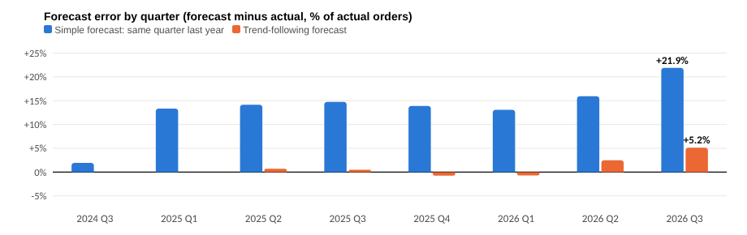
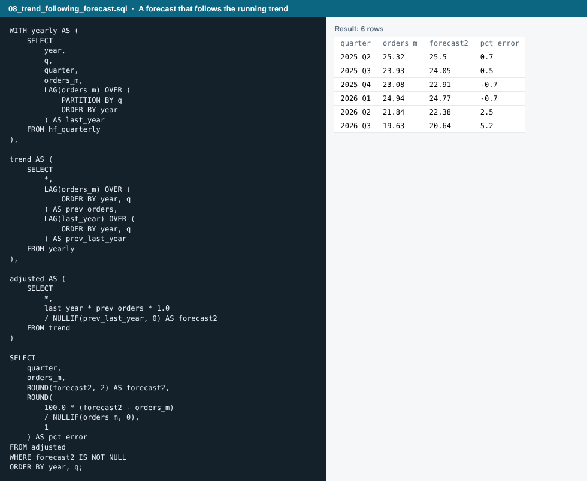

# What a simple forecast gets wrong when marketing is cut

A short, independent work sample on HelloFresh group orders, built only from the company's public reports.

**Author:** Tejaswisai Yerramsetti · November 2026



## The question

HelloFresh told investors in 2026 that orders fell as it cut marketing, and that back-to-school sign-ups in Q3 came in below its own expectations. This project asks: how wrong would a simple demand forecast have been over that period, how much does a trend-following forecast fix, and what is left over?

## What the public numbers show

1. **"Same quarter last year" was too high in all 8 quarters tested.** MAPE is 13.6% and bias is +13.6%. They are equal because every miss points the same way.
2. **Following the running trend removes most of the error.** MAPE falls to 1.7% over 6 quarters, with bias of +1.2%.
3. **Q3 2026 still stands out at +5.2%.** It coincides with the largest cut in marketing share of the year (down 3.2 points). This is consistent with the company's explanation. Four usable data points do not prove it.
4. **Forecast for Q4 2026: about 18.9 million orders, range 18.0 to 19.1 million.** The range leans below the forecast because the method has recently run high. The actual figure is due with the FY 2026 results.

The one-page summary is in [`HelloFresh_Demand_Work_Sample.pdf`](HelloFresh_Demand_Work_Sample.pdf).

## How it works

Everything is SQL on one small table. Each forecast uses only values that were known before the quarter began.

| Step | Query | What it does |
| --- | --- | --- |
| 1 to 3 | `sql/01` to `sql/03` | Look at the data, count quarters per year, find missing values |
| 4 to 5 | `sql/04`, `sql/05` | `LAG` window functions: previous row, then same quarter last year |
| 6 to 7 | `sql/06`, `sql/07` | Error, MAPE and bias of the simple forecast |
| 8 | `sql/08` | Trend-following forecast with two chained window functions |
| 9 | `sql/09` | Forecast misses next to the change in marketing share |
| 10 | `sql/10` | Q4 2026 forecast with a low and a high case |

Error is defined as forecast minus actual, as a share of actual. Positive means the forecast was too high.

Example output of query 8:



## Data

- `data/hf_quarterly.csv`: 12 quarters (Q3 2023, then Q1 2024 to Q3 2026) of group orders, revenue and marketing spend as a share of revenue.
- `data/hf_sources.csv`: the report and link behind every number.

### Data quality notes

- Quarterly orders add up to the published totals for FY 2024, FY 2025 and H1 2026 within 0.01 million.
- Marketing share is missing for Q2 2024 and Q4 2025, and derived for Q1 2024. Nothing is estimated. The `note` column explains each case.
- Q3 2025 marketing share appears as 20.0% in the 2025 statement and 20.1% on the Q3 2026 call. The later figure is used.
- Q4 2023 orders were not collected, so two quarters have no trend-following forecast. Query 4 shows how that gap silently breaks a plain `LAG`.

## Run it yourself

```bash
python run.py
```

This loads the two CSV files into an in-memory SQLite database, runs every query in `sql/`, and writes the outputs to `results/`. It needs Python 3 only.

## Limits

- Twelve company-wide quarterly points show the reasoning, not the real planning problem, which is weekly and by market and product.
- The marketing link rests on four comparable quarters.
- No internal data was used.

## What I would check with internal data

- Does the Q3 2026 miss sit in new-customer orders only, or also in existing customers?
- Does the pattern hold by market and by week?
- How early did planned marketing spend reach the demand plan?
- Do newer recipes with little history carry larger errors than established ones?

## How this was made

The SQL queries were written and run by me. AI tools were used for hints and review. The figures were collected from public HelloFresh reports and cross-checked against the company's published totals.

## Sources

HelloFresh SE press releases for Q3 2024, FY 2024, Q1 to Q3 2025, FY 2025 and Q1 to Q3 2026; the Q3 2025 quarterly statement; the Q3 2026 earnings call. Links are in `data/hf_sources.csv`.
